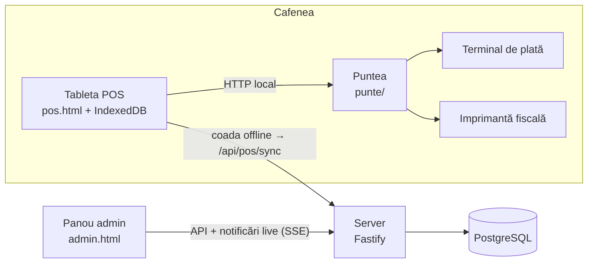

# Arhitectura și acoperirea caietului de sarcini

## Pe scurt

- **Un singur server** (Node.js + Fastify) cu PostgreSQL. Servește API-ul și interfața.
- **POS-ul e o aplicație web instalabilă (PWA)**: un service worker păstrează aplicația în tabletă,
  iar datele de lucru stau în IndexedDB. Nu depinde de internet ca să vândă.
- **Stocul și banii sunt registre**: fiecare vânzare, casare, recepție, transfer sau inventariere
  scrie mișcări (`miscari_stoc`, `miscari_bani`). Stocul scriptic e suma mișcărilor; nimic nu se
  suprascrie, deci orice cifră se poate urmări până la documentul care a produs-o (fișa articolului).

## Cum e acoperită fiecare cerință

| Cerința clientului | Cum e rezolvată | Stare |
|---|---|---|
| **1. Două module sincronizate în timp real** | POS (`web/src/pos`) și panou (`web/src/admin`) pe același API. Panoul primește notificări prin SSE (`/api/flux`) și se reîmprospătează singur la fiecare vânzare. | gata |
| **2. Trimiterea sumei la terminal, bon tipărit direct** | `web/src/pos/echipamente.ts` + `punte/`. Plata cu cardul trimite suma la terminal și salvează comanda doar după aprobare; bonul fiscal se tipărește automat, iar dacă imprimanta nu răspunde vânzarea rămâne salvată și bonul se poate retipări din Istoric. | interfață gata, **driverele reale lipsesc** (vezi întrebările) |
| Numerar cu afișare rest | Dialog cu sume rapide (exact, 50, 100, 200…) și restul afișat mare. | gata |
| Card | Suma pleacă automat la terminal; refuzul se poate reîncerca. | gata (simulator) |
| Casare fără încasare (protocol, degustări, personal, rebut) | Buton separat; motiv obligatoriu, notă opțională. Scade ingredientele, nu introduce bani, nu emite bon fiscal. | gata |
| Descărcare automată pe rețetar, cu „Lapte de ovăz” și „Extra shot” | `shared/src/calcul.ts`: rețetă + modificatori. Un modificator poate **înlocui** un ingredient (lapte → lapte de ovăz, în cantitatea din rețeta produsului) și/sau **adăuga/scădea** (extra shot +9 g cafea și +1 doză; fără zahăr −1 plic). Costul ingredientelor se salvează pe fiecare linie vândută. | gata, testat |
| **3. Închiderea turei** (doze râșniță, numerar, total card, retururi/casări) | Fereastră „oarbă”: barista introduce ce a numărat fără să vadă cifrele sistemului. Serverul calculează scripticul (numerar din registru, card din tranzacții, doze din rețetar, anulări și casări din comenzi), salvează diferențele și marchează tura pentru admin peste pragurile din Setări → Toleranțe. Adminul o marchează „verificată” cu o notă. | gata, testat |
| Calcul automat al discrepanțelor | Idem; în plus se verifică și fondul de casă la deschiderea turei (bani dispăruți între ture). | gata |
| **4. Multi-locație: depozit central + puncte de vânzare** | Fiecare locație e o gestiune separată (stoc și bani). Recepțiile (facturi de achiziție) intră de regulă în depozit și recalculează costul mediu ponderat. | gata |
| Evidența banilor pe locație | Registru de numerar pe locație: încasări, restituiri, plăți mărunte (din POS sau din panou), depuneri/ridicări, alimentări, diferențe la numărare. Cardul e urmărit pe ture și perioade. | gata |
| Transferuri interne | Un document scade din sursă și adaugă în destinație în aceeași tranzacție; avertizează dacă sursa nu are destul. | gata |
| **5. Inventariere pe tabletă, în timp real** | Din meniul POS. Raportul Scriptic / Faptic / Diferență / Valoare apare pe loc. Scripticul articolelor nenumărate se actualizează la fiecare vânzare; un articol numărat e comparat cu stocul **din momentul numărării**, deci vânzările făcute între timp nu strică diferența. La finalizare, stocul se aliniază. | gata, testat |
| **6. Offline cel puțin 24 h** | Vânzările, plățile, casările, anulările, plățile mărunte și închiderea turei se scriu întâi în IndexedDB, în aceeași tranzacție cu coada de trimis. La reconectare coada pleacă în ordine. Fiecare eveniment are un UUID creat pe tabletă, deci retrimiterea nu dublează nimic. Un eveniment pe care serverul nu-l poate aplica e păstrat pentru admin (Setări → Erori sincronizare) și nu blochează restul cozii. Momentul real al vânzării e cel de pe tabletă, deci rapoartele și stocul rămân corecte chiar dacă datele ajung a doua zi. | gata, testat în browser cu rețeaua tăiată |
| **7. Rapoarte: comparare perioade** | Oricare două intervale, pe produs sau pe categorie, cu diferența absolută și procentuală (de ex. Iced Coffee iulie vs. august). | gata |
| Profitabilitate pe produs/categorie | Încasări, cost ingrediente (la costul din momentul vânzării), marjă și marjă %. | gata |
| Consum total de materie primă | Pe locație și articol, în kg / l / buc, separat vânzări / casări, cu valoare. | gata |
| Pierderi și casări | Casări pe motive și pe produse, anulări cu ingrediente pierdute, minusuri și plusuri la inventar, diferențe de casă. | gata |

## Decizii de proiectare

- **Închidere oarbă a turei.** Dacă barista ar vedea cât „trebuie” să fie în sertar, discrepanțele
  n-ar mai spune nimic. Ea vede doar confirmarea; cifrele le vede adminul.
- **Registrul de numerar se aliniază la realitate.** O diferență la numărare se scrie ca mișcare
  („diferență la numărare”), astfel soldul din sistem pornește următoarea tură de la banii reali, iar
  lipsa rămâne vizibilă în raportul de pierderi și pe tură.
- **Anulare: preparat sau nu.** La un retur barista spune dacă produsul a fost preparat. Dacă nu,
  ingredientele revin în stoc; dacă da, rămân consumate și apar la pierderi. Banii se restituie din
  tura curentă (pe card, prin terminal).
- **Costul mediu ponderat pe toată rețeaua**, recalculat la fiecare recepție.
- **Tableta e autentificată, nu barista.** Adminul creează tableta și primește un cod de asociere
  (o singură folosire); tableta primește un token. PIN-ul baristei se verifică local (ca să meargă
  offline) și servește la atribuirea vânzărilor, nu ca protecție puternică.
- **Același cod de bază de date peste tot**: PostgreSQL în producție, PGlite în dezvoltare și teste.
  Toate testele trec pe amândouă.
- **Evenimentele care ajung târziu nu strică numărările deja făcute.** O vânzare offline sincronizată
  după finalizarea unei inventarieri era deja cuprinsă în cantitatea numărată: se compensează pe
  inventariere, la momentul numărării. La fel, o încasare în numerar ajunsă după închiderea turei
  corectează numărarea turei respective (scripticul și semnalarea), nu lasă o lipsă falsă pe tura
  următoare. Comenzile ajunse într-o tură închisă refac cifrele scriptice ale acelei ture.
- **Vânzările se raportează la data vânzării, iar o comandă anulată nu mai e vânzare.** Dacă anularea
  vine într-o altă perioadă decât vânzarea (rar: retururile se fac în aceeași tură), raportul de vânzări
  al perioadei vechi scade, iar restituirea apare în registrul de bani la data ei. Raportul de pierderi
  arată anulările la data anulării.
- **Securitate pe măsura unei cafenele, nu a unei bănci.** Tokenul de sesiune circulă doar în antet
  (fluxul de notificări folosește bilete de un minut), loginul are pauze după încercări greșite,
  schimbarea parolei închide celelalte sesiuni, tableta poate declara doar bariste din locația ei, iar
  puntea de echipamente cere un secret și verifică originea paginii.

## Limitări cunoscute (de rezolvat în etapele următoare)

- **Echipamentele reale nu sunt încă legate**: există interfața și simulatorul, lipsesc driverele pentru
  modelele concrete.
- La o plată cu cardul care expiră (terminalul nu răspunde), reîncercarea poate duce la dublă debitare
  dacă terminalul a aprobat totuși; protocoalele ECR au de obicei o comandă „ultima tranzacție”, care
  se va folosi în driver.
- Un eveniment respins de server pentru format invalid nu poate fi corectat din panou; se marchează
  rezolvat, iar operațiunea se reface manual. Tableta verifică aceleași limite înainte de a salva, deci
  cazul apare doar la date corupte.
- Operațiunile de casă introduse din panou (depuneri, alimentări) au data introducerii, nu una aleasă.
- Inventarierea cere internet (scripticul vine de pe server). Vânzarea merge în continuare offline.
- Momentul vânzării vine de la ceasul tabletei; tabletele trebuie să aibă ora setată automat.
- Același preț în toate locațiile; fără reduceri, carduri de fidelitate sau mese/comenzi deschise.
- Un singur rol de administrator (fără manager pe locație).
- O singură casă (sertar de numerar) pe locație: dacă o cafenea are două tablete cu sertare separate,
  registrul de numerar trebuie împărțit pe tabletă.
- Rețetele modificate se aplică și vânzărilor offline care ajung pe server după modificare.

## Ce trebuie aflat de la client

1. **Terminalul de plată**: banca (MAIB, Moldindconbank, Victoriabank, OTP etc.) și modelul
   terminalului; banca trebuie să ofere documentația protocolului de integrare cu casa (ECR).
2. **Casa de marcat / imprimanta fiscală**: modelul (Datecs, Tremol, Daisy…) și cum se conectează
   (USB, serial, rețea). În Moldova bonul fiscal trebuie emis de o mașină de casă și control înregistrată
   la SFS; de confirmat cu contabilul cum se integrează soluția aleasă.
3. **Tabletele**: Android sau iPad? Pentru Android putem face și o aplicație instalabilă cu puntea
   inclusă, fără calculator separat.
4. **Găzduirea**: unde rulează serverul (VPS, domeniu, HTTPS, copii de siguranță).
5. **Contorul râșniței**: ce înseamnă o „doză” (simplă sau dublă)? Rețetarul e configurat pe doze de 9 g.
6. **Pragurile de alertă**: ce diferență de bani / doze e acceptabilă la închiderea turei.
7. **Contabilitate**: e nevoie de export (de ex. către 1C) sau de facturi fiscale către persoane juridice?
8. **Prețuri diferite pe locații, reduceri, program de fidelitate?** Nu sunt în caietul de sarcini.
